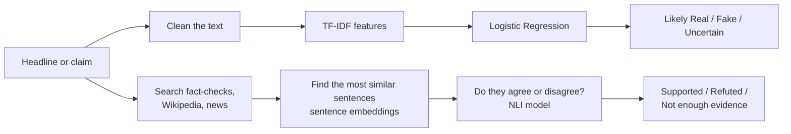

# TruthLens: Project Overview

*NLP lab project · Prepared by: ______________________*

---

## 1. What the project does

Fake news spreads quickly, and a single headline is often all people read. **TruthLens** is a web
app where you paste a news headline or a short claim and get two answers:

1. **Does it read like fake news?** The app studies the *wording* of the headline.
2. **What do other sources say?** The app searches fact-checking sites, Wikipedia and news archives,
   and checks whether they agree or disagree with the claim.

The app shows both answers side by side, with the reasons behind them: which words mattered, and
which sentence from which source decided the result. It always presents its output as an
*estimate*, never as "verified true" or "confirmed fake".

---

## 2. Why two answers?

| | Part 1: Writing style | Part 2: Evidence check |
|---|---|---|
| Question it answers | Does this *sound* like fake news? | Do reliable sources agree with it? |
| Main NLP idea | Text classification | Semantic search + Natural Language Inference |
| Result | Likely Real / Likely Fake / Uncertain | Supported / Refuted / Not enough evidence |
| Good at | Fast, works offline, easy to explain | Based on real facts and sources |
| Weak at | It judges the style, not the facts | Depends on finding the right article |

A fake story can be written calmly, and a true story can be written dramatically. A style model alone
can be fooled by this, so we added a second check based on facts.

---

## 3. How it works (big picture)

---

## 4. Part 1: Writing-style classifier

### Dataset

We trained on two datasets and use **only the headlines**:
- **ISOT Fake News Dataset** (US news, 2016–17): about 45,000 articles. Real news is from Reuters,
  and fake news is from websites flagged by fact-checkers.
- **Indian Fake News Dataset (IFND)** (Indian news, 2013–21): about 56,700 headlines. Real news is
  from Indian newspapers (The Tribune, The Statesman, ThePrint, …), and fake news is from Indian
  fact-checkers (Alt News, BOOM, India Today, …). We added it so the model knows Indian names and
  topics (RBI, ISRO, MSP, Lok Sabha), which the US-only model had never seen.

**Cleaning IFND.** Two problems in IFND would have let the model score well for the wrong reason:
- About 81% of its "fake" headlines are written by fact-checkers, such as *"Fact Check: No, this photo
  is not from Kashmir"*. The model would learn to spot the words "fact check" instead of fake news.
  So we remove words like "fact check", "false", "viral", "hoax" and "claim" from every IFND headline.
- Its apostrophes are broken in a different way in each class (`۪` in real rows, `’` in fake
  rows), so the model could tell the classes apart from junk characters. We repair them first.

### Step 1: Text cleaning

Before the computer learns anything, every headline is cleaned the same way:
- convert to lowercase,
- remove tags like `[VIDEO]` or `BREAKING:`.

**Why remove the tags?** They appear almost only on fake websites. If we kept them, the model would
learn "this came from a fake website" instead of learning about the language itself. This mistake is
called **data leakage**.

We **keep** words like *not* and *never*, because "will approve" and "will **not** approve" mean
opposite things.

### Step 2: Turning words into numbers (TF-IDF)

A computer cannot read text, so each headline is turned into a list of numbers using
**TF-IDF (Term Frequency – Inverse Document Frequency)**:
- **TF:** how often a word appears in this headline.
- **IDF:** how rare the word is across all headlines. Common words like *the* get a low score;
  distinctive words like *slams* or *shocking* get a high score.

We look at single words and also **two-word phrases** (bigrams), such as *"says minister"* or
*"you won't"*, because phrases carry more meaning than single words.

**Why TF-IDF?** It is simple and fast, and every number can be traced back to a word, so the result
is easy to explain.

### Step 3: Classification (Logistic Regression)

**Logistic Regression** learns a weight for every word or phrase. Some words push a headline toward
"fake" and others toward "real". The model adds these up and gives a **probability**, for example
"78% likely fake".

**Why Logistic Regression?**
- It works very well with TF-IDF features and is a standard model for text classification.
- It gives a probability, not just a yes/no answer.
- It is **explainable**: we can show exactly which words pushed the decision and how strongly.
- It trains in seconds on a normal laptop.

We also trained **Naive Bayes**, another classic text classifier, on the same data and compared
the two to justify our choice.

### Step 4: Honest output

- If the probability is close to 50/50 (between 40% and 60%), the app says **Uncertain** instead
  of forcing an answer.
- The app shows a chart of the words that influenced the decision.

### How we tested it

Before splitting, we removed duplicate headlines so the same headline couldn't appear in both parts.
This left **87,239 headlines** (48,523 Indian and 38,716 US; 53,235 real and 34,004 fake). We split
them: **80% to train** (69,791) and **20% to test** (17,448 headlines the model has never seen),
keeping the same mix of datasets and classes in both parts. We measure **accuracy, precision, recall
and F1 score**, overall and separately for Indian and US headlines.

---

## 5. Part 2: Evidence check

This part follows the standard **fact-verification** approach used in NLP research:
**search for evidence → pick the relevant sentences → decide if they agree or disagree.**

### Step 1: Search for evidence

The claim is searched in:
- **Google Fact Check API:** articles from fact-checkers such as PolitiFact, Snopes and Alt News.
- **Wikipedia:** the top matching articles.
- **News archives:** Wikipedia's daily news summaries and the GDELT news database.

**Turning a fact into a sentence.** Some fake news is about something that never happened, for example
*"Narendra Modi committed suicide"*. No article will ever say "Modi did not commit suicide", so there
is nothing to contradict the claim directly. But Wikipedia files every biography under either
*"Living people"* or a category like *"2024 deaths"*. For a person, the app turns this into one plain
sentence, *"Narendra Modi is alive."*, and lets the NLI model judge it like any other evidence. The
model sees that "is alive" contradicts "committed suicide", so the claim is **Refuted**.

### Step 2: Find the most relevant sentences (sentence embeddings)

The search returns hundreds of sentences. To find the ones closest in **meaning** to the claim, we
use a pretrained model called **MiniLM**. It converts each sentence into a vector (a list of
numbers) so that sentences with similar meanings are close together, even when the words differ.
For example, *"the bill was approved"* and *"parliament passed the law"* come out close.

We compare the vectors using **cosine similarity** and keep the 15 most similar sentences.

**Why not TF-IDF here?** TF-IDF only matches exact words. Evidence usually says the same thing in
*different words*, and embeddings understand meaning.

### Step 3: Agree or disagree? (Natural Language Inference)

**Natural Language Inference (NLI)** is an NLP task: given two sentences, decide whether the first
one **supports** the second, **contradicts** it, or is **unrelated**.

| Evidence sentence | Claim | NLI result |
|---|---|---|
| "The Great Wall cannot be seen from the Moon with the naked eye." | "The Great Wall is visible from the Moon." | Contradicts |
| "Chandrayaan-3 landed near the Moon's south pole in 2023." | "India landed a spacecraft on the Moon." | Supports |

We use a pretrained transformer model, **DeBERTa-v3**, that was trained on large NLI datasets.

**Why two different models?** MiniLM is fast, so it can quickly shortlist hundreds of sentences.
DeBERTa is slower but much more accurate, because it reads the claim and the sentence *together*.
So the fast model shortlists and the accurate model judges.

### Step 4: Final verdict

1. If a fact-checker has already checked the **same** claim, their rating is used.
2. Otherwise, the most relevant sentence that the model is confident about decides:
   **Supported** or **Refuted**. That sentence must also contain most of the claim's key words,
   including the names. Without this rule, *"Minister Arvind Sawant resigned from the cabinet"*
   was wrongly taken as proof that *"Narendra Modi resigned"*, because the NLI model only noticed
   that both sentences were about resigning.
3. If nothing clear is found, the result is **Not enough evidence**. This does not mean the claim is
   false, only that no source settled it.

If PyTorch (needed for these models) is not available, the app falls back to simple keyword matching
so that it still works.

---

## 6. Example

Claim: **"The Great Wall of China is visible from the Moon with the naked eye"**

| Part | Result |
|---|---|
| Writing style | **Uncertain.** The sentence is calm and factual in tone, so style gives no clear signal. |
| Evidence check | **Refuted.** Wikipedia says: *"The Great Wall of China cannot be seen by the naked human eye from the Moon…"* |

This shows why both parts are needed: the style model cannot catch a false claim that is written
calmly, but the evidence check can.

---

## 7. Results

**Writing-style classifier** (17,448 test headlines; "fake" is the positive class):

| Model | Accuracy | Precision | Recall | F1 |
|---|---|---|---|---|
| Logistic Regression | 92.00% | 92.41% | 86.60% | 89.41% |
| Naive Bayes | 92.15% | 93.25% | 86.10% | 89.53% |

| Logistic Regression, by dataset | Test headlines | Accuracy | F1 |
|---|---|---|---|
| Indian news (IFND) | 9,705 | 91.87% | 87.36% |
| US news (ISOT) | 7,743 | 92.17% | 91.26% |

The two models score almost the same. We use Logistic Regression because it gives a clear weight for
every word (so the app can explain each prediction) and well-behaved probabilities (needed for the
"Uncertain" zone). Trained on US news alone, the model scored 94.07% on US headlines; adding Indian
news costs about 2 points there but lets the model read Indian headlines. On 16 new Indian headlines
we wrote ourselves, it recognised 83–100% of the words instead of 50–92%.

The words it relies on most show it learned **style**: "says", "sc" (Supreme Court), "probe",
"centre" and "court" push toward real (newspaper habits), while "video", "photo", "old", "image" and
"hillary" push toward fake (Indian misinformation is often an old or edited photo or video).

**Evidence check** (10 test claims):
- 10/10 correct with the Fact Check API key. These claims were also used to tune the settings, so
  this is a best case.
- 8/10 on 10 new claims that were not used for tuning.
- 7/10 without the API key. The three misses were hoaxes that only fact-checkers had covered, so
  the app answered "Not enough evidence" rather than guessing.

---

## 8. Limitations

- **Style is not truth.** The classifier learns how fake websites *write*, not whether a story is
  true.
- **Old data.** US news from 2016–17 and Indian news from 2013–21. Even after cleaning, the Indian
  fake headlines are mostly fact-checkers' wording, so words like "photo" and "video" lean fake.
- **Search can miss.** If the wrong article is found, the evidence check reasons about the wrong text.
- **Recent or local news** may not be covered in any source yet.

---

## 9. Summary of NLP concepts used

| Concept | What it does in TruthLens |
|---|---|
| Text preprocessing | Cleans headlines and removes tags that would leak the source |
| N-grams (bigrams) | Captures short phrases, not just single words |
| TF-IDF | Turns headlines into numbers, giving more weight to distinctive words |
| Logistic Regression | Classifies a headline as likely real or fake, with a probability |
| Naive Bayes | Baseline model for comparison |
| Precision, recall, F1 | Measure how well the classifier works |
| Sentence embeddings (MiniLM) | Find evidence sentences with similar meaning |
| Cosine similarity | Measures how close two sentence meanings are |
| Natural Language Inference (DeBERTa) | Decides whether evidence supports or contradicts the claim |

**Tech used:** Python, scikit-learn, Hugging Face Transformers, Sentence-Transformers, Streamlit.

